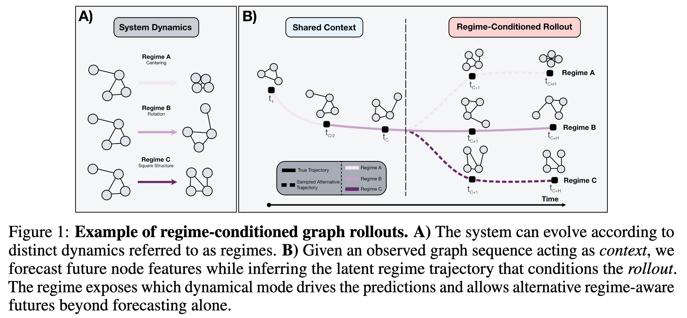

<h1 align="center">HERON</h1>

<h3 align="center"><em>Hierarchical Regime-Conditioned Dynamics for Spatiotemporal Graphs</em></h3>

<p align="center"><strong>Accepted at <em>NeurIPS 2026</em></strong></p>

---

[](https://arxiv.org/abs/2611.20835)
[](pyproject.toml)
[](https://pytorch.org/)
[](mailto:jeremy.baffou@epfl.ch)
[](https://jerbaf.github.io/)

## 🧩 Abstract

Official PyTorch implementation of **HERON** (**H**i**E**rarchical **R**egime-c**O**nditioned dy**N**amics).

Forecasting the behavior of spatio-temporal systems often requires more than accurate predictions: models should
uncover the dynamical modes governing future evolution. Existing temporal graph and latent dynamical models achieve
strong forecasting performance, but their latent representations often entangle multiple dynamical patterns, limiting
interpretability. Conversely, regime-inference methods explicitly model such modes but typically do not support
forecasting over graph-structured systems. We introduce HERON, a self-supervised regime-aware generative framework
that unifies graph-structured trajectory generation with regime identification. HERON factorizes the latent state
into discrete system-level regimes, capturing global dynamical modes, and continuous entity-level dynamics, yielding
a modular regime interface compatible with existing spatio-temporal frameworks. Crucially, the inferred regime
actively conditions system dynamics, enabling regime tracking and controlled simulations under alternative dynamical
modes. Without regime annotations, HERON jointly learns forecasts and regime dynamics in a self-supervised manner,
recovering meaningful modes across controlled synthetic and real-world datasets while maintaining competitive
forecasting performance. These results open a path toward interpretable, controllable generative modeling of
spatio-temporal dynamics.



## ⚙️ Installation

Experiments run in a Docker image that provides the environment. Build it from the repository root:

```bash
docker build -t heron .
```

## 📦 Datasets

**Synthetic benchmarks.** The three synthetic datasets of the paper, linear dynamics without interactions,
Gompertz growth on an evolving topology, and network interaction dynamics, each with three regimes and windows of
C = H = 5 steps, can be downloaded from [Google Drive](https://drive.google.com/drive/folders/1HEmvl_AoBX08lkTIlfr154YAyVZIg-7q?usp=sharing). Each dataset is a directory of window files, which a
config reads through `data.root`:

```bash
python scripts/run_test.py --config configs/network.yaml data.root=/datasets/network
```

**Real-world benchmarks.** The SportVU NBA and AMASS + BABEL datasets cannot be redistributed under their licenses,
and are therefore not shared here. They can be rebuilt from their original sources following Appendix 10.4 of the
paper, and trained with `configs/nba.yaml` and `configs/amass.yaml` (C = 8, H = 12).

| | Sources | Regimes | Graph |
|---|---|---|---|
| NBA | tracking data from [NBA-Player-Movements](https://github.com/linouk23/NBA-Player-Movements), train/test partition of Yue et al. (2014) | play outcome, score or rebound | 10 players and the ball, fully connected with node position, entity type, edge distance and team indicator |
| AMASS + BABEL | motion from [AMASS](https://amass.is.tue.mpg.de/) (BMLmovi, BMLrub, CMU, KIT), actions from [BABEL](https://babel.is.tue.mpg.de/) | BABEL actions pooled into step/walk, stand, turn and sit/lower. | SMPL 22-joint skeleton; with attributes being node position, joint type, laterality and distance to the pelvis, static limb, length and laterality edge features |

**New dataset.** If you want to create your own dataset, we model datasets as directory of `.pt` files, one window of T = C + H graph snapshots per file, each storing a dictionary:

| key | shape | content |
|---|---|---|
| `x` | `[T, N, F]` | node features, where the id `n` in the feature matrix refers to the same entity at every step |
| `node_mask` | `[T, N]` | entity `n` exists at step `t` (as entities may appear and disappear later) |
| `edge_index` | `[2, E]` or list of `T` × `[2, E_t]` | topology in node indices |
| `edge_attr` | `[E, D_e]` or list of `T` × `[E_t, D_e]` | edge features |
| `y` | `[T]` | regime label per step (`-1` if unknown), used for evaluation only |
| `seq_id` | int | optional; windows of one sequence never cross splits |
| `split` | str | optional; `"test"` pins the window to the test set, e.g. an official partition |

[`examples/toy_dataset.py`](examples/toy_dataset.py) writes a small dataset in this format and serves as a template.

## 🚀 Training

A HERON instance is described by a YAML config with `data`, `model`, `loss` and `train` sections. To train HERON on a new dataset, you need only a few lines!

```yaml
data:
  root: /datasets/my_data
  context: 8                 # C
  horizon: 12                # H
  dynamic_dims: [0, 1]       # node features that evolve and are forecast; the others are static descriptors
model:
  num_regimes: 4             # K
out_dir: runs/my_data
```

You can perform training as such:

```bash
python scripts/run_test.py --config configs/my_data.yaml   # train, then evaluate once on a held-out test split
python scripts/run_cv.py --config configs/my_data.yaml     # 4-fold cross-validation on the training pool
python -m heron.search --config configs/my_data.yaml --space configs/search.yaml --out runs/search --trials 0-7
```

When the number of regimes is unknown, K can be chosen at the elbow of the validation horizon NLL reported by
`run_cv.py`. See paper for more details.

**Modularity.** The regime pathway is independent of the entity-level dynamics model. Any latent graph-temporal
model with a per-entity recurrent state can serve as the backbone, and HERON adds the system-level state, the regime
inference, the regime-gated experts, the decoder, the objective and the autonomous rollout around it. If you have a backbone, you can modulate it to implements two methods for compatibility (check [`heron/backbone.py`](heron/backbone.py)):

```python
import torch
from heron import Backbone


class MyBackbone(Backbone):
    """ Custom entity-level transition, built as MyBackbone(latent_dim, entity_hidden_dim, **kwargs). """
    def init_states(self, B: int, N: int, like: torch.Tensor):
        """ Initialize the states before the first step, as a tensor or a tuple of tensors. """
        ...

    def forward_one_time_step(self, states, z: torch.Tensor, edge_index: torch.Tensor,
                              alive: torch.Tensor) -> tuple:
        """ Compute the entity states h^i_t = f(h^i_{t-1}, z^i_{t-1}, E_t) for one time step. """
        ...  # entities not alive at t-1 restart from the initial state
        return states, h  # h: [B, N, entity_hidden_dim], read by the rest of HERON
```

The backbone is driven by the entity latents, so the forecast remains an autonomous
rollout. The relational encoder is swappable in the same way (`heron.Encoder`, e.g. a set transformer in place of
the default GINE layers). Both are selected in the config by import path and keyword arguments. [`examples/graph_gru.py`](examples/graph_gru.py) is a short, complete backbone that mixes neighbouring entity states before the recurrent update:

```yaml
model:
  backbone: {class: examples.graph_gru:GraphGRU, hops: 1}   # default: {class: gru}, standalone HERON
  encoder: {class: gine}                                    # default
```

Two variants from the paper's appendix are configuration switches: `model.routing=soft` mixes the experts with the
posterior regime probabilities, and `loss.balance_target=learned` replaces the uniform regime-usage target with a
slowly learned prior for imbalanced regimes.

**Using a trained model.** If you want to use a HERON checkpoint for inference, you can do the following:

```python
from heron import collate, load_model, load_window

model, config = load_model("runs/my_data/test/best.pt")
batch = collate([load_window(path) for path in paths])
forecast = model.forecast(batch)                      # mean rollout from the C context snapshots
forecast.positions, forecast.context_regimes, forecast.horizon_regimes
model.forecast(batch, mode="sample")                  # one stochastic rollout
model.forecast(batch, clamp_regime=1)                 # the same horizon under regime 1
```

It will forecast from context windows alone, exposes the inferred regimes, and simulates the horizon under the chosen regime.

## 📝 Citation

```bibtex
@inproceedings{baffou2026heron,
  title     = {Hierarchical Regime-Conditioned Dynamics for Spatiotemporal Graphs},
  author    = {Baffou, Jeremy and Frossard, Pascal and Thanou, Dorina},
  booktitle = {Advances in Neural Information Processing Systems},
  year      = {2026}
}
```
